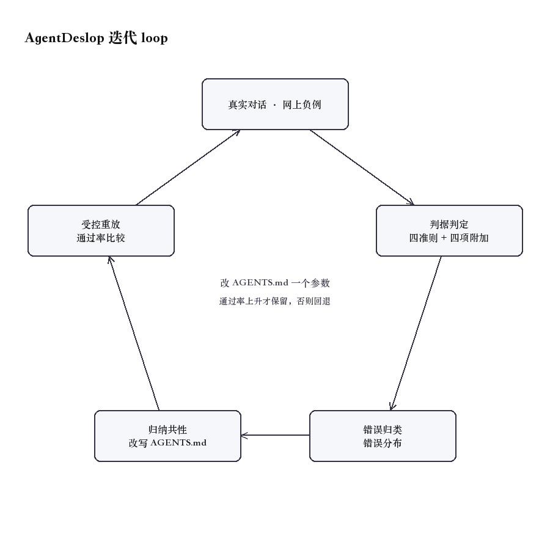

# "Agent.md" 的除味剂

AI怪味的成因可能当前还不清楚，另外对常用的模型普通人也难以后训练或PEFT。故暂时用修改agent.md的方案来注入一些需求，不见得有效，但希望泛用性好一些。

## 项目性质

这是一个方法性项目：研究如何一步步迭代修改 AGENTS.md，让模型输出的 AI 味下降。仓库里的规则文本是这套方法的一次实例，不是项目本身。

方法由两段闭环组成，接口是同一批 case 与同一套判据。前一段负责发现问题：收集真实对话中的失败，归类，按判据逐条判定，得到错误分布。后一段负责改进：从同类错误的共性找条款根因，改写规则，再整批重放验证。

## 目标

把 AGENTS.md 当作唯一的可调参数，按下面的目标函数优化：

```
R(agent.md) = Σ_{x, y ∈ B} 1[ LLM(x; agent.md) ≠ y ] · GriceanCriterion( LLM(x; agent.md) )
```

B 是负面案例集，x 是触发问题，y 是令人厌恶的样例输出。方括号判断回答是否没有复现 y。GriceanCriterion 按量、质、关系、方式四准则判定，并把代词、口语、单字动词、拟人四类禁用项作为附加判据。

判定由语言模型执行，正则检测器只做预筛。四准则与附加判据的细则见 [judge-prompt.md](pipeline/judge-prompt.md)。

## 系统设计



图中五个环节连成一个 loop：真实对话与网上负例进入判据判定，按十四类错误原因归类得到错误分布；归纳同类错误的共性后改写 AGENTS.md；新规则经受控重放，通过率上升才保留，否则回退；结果回写到新一轮的 case 收集。

## 快速开始

```sh
python3 pipeline/build_badcases.py
python3 pipeline/evaluate.py --rules rules/AGENTS-v0.md --label v0
python3 pipeline/scan_badcases.py outputs/eval/v0.jsonl
python3 pipeline/judge.py outputs/eval/v0.jsonl
```

## 目录

| 路径 | 内容 |
|---|---|
| `rules/` | 规则版本，`AGENTS-v0.md` 为迭代起点 |
| `data/cases-raw.md` | 用户反馈的原始 case，73 条 |
| `data/badcases-v3.jsonl` | 网上负例，210 条 |
| `pipeline/` | 负例生成、受控采样、预筛、评审任务 |
| `outputs/eval/` | 评测答案与规则指纹 |
| `docs/` | 方法说明与系统设计图 |

## case 的结构

每条 case 记录一次真实失败：场景上文、用户原话、当时的错误回答、错误原因。错误原因分十四类，例如意图误读、未经授权动作、用语违规、报告代替动作、目标偏移。

case 不是条款清单。单条 case 只作为证据，不作为追加条款的理由。

## 修改规则的方式

新 case 先按错误原因归类，再看同类错误的共性，判断问题出在条款缺失、表述模糊、不可执行，还是与既有条款冲突。然后改条款本身：能合并的合并，能改写的改写，只有现有条款覆盖不到时才新增，新增后检查条款总数是否需要删减。

改完用整批 case 重放，通过率上升才保留，否则回退。规则版本留在 `rules/`，差异由 git 记录。

## 评测

受控评测使用独立 `DSH_HOME`、空工作区与 headless profile，规则唯一来源是该 home 下的 AGENTS.md，避免多份规则同时注入。每次评测记录规则 sha256、问题与答案，写入 `outputs/eval/<label>.jsonl`。

换模型后旧条款可能失效，按同样流程重新收集 case、重新判断、重新修改，不照搬旧条款。

## 数据来源

网上负例覆盖五类：句式与结构 53、英文高频词 50、语气与防御 43、中文套话 34、英文套话 30。来源包括 tropes 清单、AI 高频词表、Wikipedia AI 写作标志、文本 slop 模式、中文去 AI 味指南与 hedging 清单，详见 [data/network-badcases-notes.md](data/network-badcases-notes.md)。

## License

MIT，见 [LICENSE](LICENSE)。
